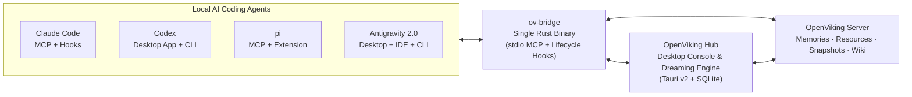

<div align="center">

# OpenViking Hub

**One shared long-term memory for all your local AI coding agents.**

[](https://github.com/tianmazi/openviking-hub/releases)
[](https://github.com/tianmazi/openviking-hub/actions)
[](https://github.com/tianmazi/openviking-hub/releases)
[](https://github.com/tianmazi/openviking-hub)

**English** | [简体中文](README.zh-CN.md)

[Download Latest Release](https://github.com/tianmazi/openviking-hub/releases) · [User Guide](docs/USER_GUIDE.md) · [Architecture & Design](docs/DESIGN.md)

</div>

---

## What It Does

If you switch between **Claude Code**, **Codex**, **pi**, and **Antigravity**, each agent keeps its own isolated notes and forgets what the others learned. **OpenViking Hub** connects them to one shared [OpenViking](https://docs.openviking.ai/en/) memory server with a desktop control plane, a zero-dependency Rust bridge (`ov-bridge`), and a **PR-style Dreaming review console** that keeps memory accurate, compact, and safe.



---

## Supported Agents

| Agent | Surfaces Supported | Integration Mode | Auto-Backup & One-Click Rollback |
| :--- | :--- | :--- | :---: |
| **Claude Code** | CLI & IDE | MCP + Lifecycle Hooks (`~/.claude.json`, `~/.claude/settings.json`) | ✅ |
| **Codex** | Desktop App + CLI | MCP + Hooks (`$CODEX_HOME/config.toml`, comment-preserving `toml_edit`) | ✅ |
| **pi** | CLI | MCP + Native Extension (`~/.pi/extensions/openviking-bridge/`) | ✅ |
| **Antigravity (反重力 2.0)** | Desktop App + IDE + CLI | Global MCP + Hooks (`~/.gemini/config/`) | ✅ |
| **Windows WSL** | Any WSL distro | Cross-UNC injection with forced LF line endings | ✅ |

All config edits write atomically and save timestamped backups to `~/.openviking/backups/` before touching any file.

---

## Quick Start (3 Steps)

### 1. Install OpenViking Hub
Download the installer for your OS from [GitHub Releases](https://github.com/tianmazi/openviking-hub/releases):
- **macOS**: Apple Silicon (`aarch64.dmg`) or Intel (`x64.dmg`)
- **Windows**: `.msi` / `.exe` installer (includes WSL bridge support)
- **Linux**: `.AppImage` / `.deb`

### 2. Connect Your OpenViking Server
Open **OpenViking Hub**, enter your OpenViking server URL and API Key (multi-profile supported), and click **Test Connection**.

### 3. One-Click Connect Your Agents
Go to the **Agents** tab, pick your installed agents (Claude Code, Codex, pi, Antigravity, or WSL distros), and click **Connect**.
- `ov-bridge` is automatically extracted to `~/.openviking/bin/` — **no Node.js, `npx`, Python, or Bash required**.
- Keep coding as usual: memories are automatically scoped by project, recalled within your token budget, and staged for background Dreaming review.

> **Privacy Note**: Capture does not scrub secrets before ingest. Toggle **Privacy Mode** anytime from the sidebar or system tray to pause capture immediately — skipped turns leave a watermark so turning capture back on never backfills private conversations.

---

## Key Capabilities

### 1. Precision Context Assembly & Prompt-Injection Defense
- **Less-is-more recall gating**: Configurable minimum similarity threshold (`min_recall_score`, default `0.60`) and strict per-turn item cap (`max_recall_items`, default `3`) prevent noisy matches from diluting agent attention.
- **Tiered L0 → L1/L2 budgeting**: Per-agent token budgets, six-category quotas (`profile`, `preferences`, `entities`, `events`, `cases`, `patterns`), and automatic L1 expansion for high-confidence hits.
- **IFC read-only boundary**: Every recalled block is wrapped in `<openviking_memory_reference readonly="true">` with closing-tag escaping so untrusted memory text cannot hijack system instructions.
- **Protected rule files**: `CLAUDE.md`, `AGENTS.md`, `.cursorrules`, and `.agents/rules/**` are read-only by default and never overwritten by memory consolidation.

### 2. Dreaming Background Consolidation & PR-Style Review
Run Dreaming on a schedule (`cron`), by session count, or on demand — then inspect proposals with line-by-line diffs (`J/K/A/X/E/⌘↵`) before anything touches remote memory:
- **5 Knowledge Relations**: Classifies overlapping memories into `DUPLICATES`, `UPDATES`, `EXTENDS`, `CONFLICTS` (forced high-risk, never auto-archived), and `DERIVES` using deterministic rules, local CLI (`claude -p` / `codex exec`), or an OpenAI-compatible endpoint (e.g. Ollama).
- **Version Lineage (`superseded`)**: Replaced facts are archived to `archive/merged-*` with `status: superseded` and `superseded_by` pointers rather than blindly overwritten.
- **Top-Layer Pruning (`DemoteFromIndex`)**: Automatically proposes demoting cold or oversized `index_priority: high` entries back to normal so startup context stays lean.
- **Incremental Local Transcript Verification**: Tracks outbox watermarks and cross-checks recently changed notes against committed local session transcripts (`skipped` privacy turns excluded) to catch factual drift.
- **Event TTL Auto-Expiry**: Respects Frontmatter `expires_at` (and optional `events` default TTL) — expired memories are blocked from recall immediately and archived to `archive/expired-*`.
- **Snapshot & Rollback**: Every commit creates an OpenViking snapshot, checks SHA-256 `base_hash` against remote drift, and supports one-click batch rollback.

### 3. Live Observability & Multi-Profile Control
- Switch between work/personal OpenViking profiles with strict SQLite & recall isolation.
- Watch live agent-to-memory flow animations, inspect recall latency/token events, and browse L0/L1/L2 layers in the built-in Explorer.

---

## Development & Testing

### Repository Layout
```text
openviking-hub/
├── Cargo.toml                         # 3-crate Rust workspace
├── crates/
│   ├── ov-core/                       # OpenViking client, policy engine, 4 Agent + WSL adapters, Dreaming + SQLite
│   └── ov-bridge/                     # Zero-dependency Rust sidecar (mcp / hook / sync / doctor) + E2E tests
├── src-tauri/                         # Tauri v2 desktop shell (tray, sidecar installer, scheduler, IPC)
├── src/                               # React + TypeScript + Tailwind CSS console & Dreaming workbench
├── docs/                              # USER_GUIDE.md & DESIGN.md
└── .github/workflows/release.yml      # 4-platform CI & release pipeline
```

### Build & Run Tests
```bash
# Rust unit + end-to-end tests (spawns mock OpenViking server + real ov-bridge)
cargo test -p ov-core -p ov-bridge

# Build standalone ov-bridge binary
cargo build --release -p ov-bridge

# Frontend dev preview (with mock data), typecheck/build, and E2E smoke test
npm install
npm run dev
npm run build
npm run test:e2e

# Run or bundle the Tauri v2 desktop app
npm run tauri dev
npm run tauri build
```

Pushing a version tag (e.g. `git tag v0.6.1 && git push origin v0.6.1`) automatically builds and publishes installers for macOS (Apple Silicon & Intel), Windows, and Linux to [GitHub Releases](https://github.com/tianmazi/openviking-hub/releases).
