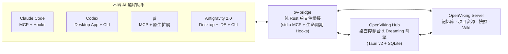

<div align="center">

# OpenViking Hub

**让你的所有本地 AI 编程助手，共享同一套长期记忆。**

[](https://github.com/tianmazi/openviking-hub/releases)
[](https://github.com/tianmazi/openviking-hub/actions)
[](https://github.com/tianmazi/openviking-hub/releases)
[](https://github.com/tianmazi/openviking-hub)
[](LICENSE)

[English](README.md) | **简体中文**

[下载最新版本](https://github.com/tianmazi/openviking-hub/releases) · [完整使用手册](docs/USER_GUIDE.md) · [架构与设计文档](docs/DESIGN.md)

</div>

---

## 这个项目解决什么问题？

如果你日常会在 **Claude Code**、**Codex**、**pi** 和 **Antigravity（反重力 2.0）** 之间切换，每个 Agent 都有自己割裂的上下文，在一个工具里踩过的坑、定好的项目规范，换个工具又要从头讲一遍。

**OpenViking Hub** 是一个跨平台桌面控制台，帮你把这些本地 Agent 一键接入同一个 [OpenViking](https://docs.openviking.ai/en/) 记忆服务：通过零依赖的纯 Rust 桥接引擎（`ov-bridge`）按预算精准召回记忆，并在后台通过 **Dreaming 整理流水线 + PR 式审核台**持续去重、纠错、瘦身和归档。



---

## 支持的 Agent 与平台

| Agent | 支持形态 | 接入方式 | 修改前自动备份 & 一键回滚 |
| :--- | :--- | :--- | :---: |
| **Claude Code** | CLI / IDE | MCP + Hooks（`~/.claude.json`、`~/.claude/settings.json`） | ✅ |
| **Codex** | Desktop App + CLI | MCP + Hooks（`$CODEX_HOME/config.toml`，`toml_edit` 无损保留注释） | ✅ |
| **pi** | CLI | MCP + 原生扩展（`~/.pi/extensions/openviking-bridge/`） | ✅ |
| **Antigravity（反重力 2.0）** | Desktop App + IDE + CLI | 全局 MCP + Hooks（`~/.gemini/config/`） | ✅ |
| **Windows WSL** | 任意 WSL 发行版 | 跨 UNC 路径自动注入（强制 LF 换行） | ✅ |

所有配置文件修改均采用原子写入，并在改动前备份至 `~/.openviking/backups/`，可随时一键卸载恢复。

---

## 3 步快速上手

### 1. 下载安装
前往 [GitHub Releases](https://github.com/tianmazi/openviking-hub/releases) 下载对应平台安装包：
- **macOS**：Apple Silicon（`aarch64.dmg`）或 Intel（`x64.dmg`）
- **Windows**：`.msi` / `.exe` 安装包（内置 WSL 注入支持）
- **Linux**：`.AppImage` / `.deb`

### 2. 连接 OpenViking 服务
打开 **OpenViking Hub**，填入你的 OpenViking 服务地址和 API Key（支持多套工作/个人 Profile 隔离切换），点击 **测试连通**。

> **本机还没启动 OpenViking Server？** 用 `uv` 或 Docker 约 1 分钟即可拉起本地服务（详见 [OpenViking 官方快速开始](https://docs.openviking.ai/en/getting-started/02-quickstart)）：
> ```bash
> # 方式 A：uv（Python 3.13）
> uv tool install --python 3.13 openviking && openviking-server init && openviking-server
>
> # 方式 B：Docker（国内如拉取慢可替换为 openviking-cn-beijing.cr.volces.com/volcengine/openviking:latest）
> docker run -d --name openviking -p 127.0.0.1:1933:1933 -v ~/.openviking:/app/.openviking ghcr.io/volcengine/openviking:latest
> ```
> 如果只想先体验界面，直接运行 `npm run dev` 即可进入零后端 Mock 预览模式。

### 3. 一键接入本地 Agent
进入 **Agents** 页面，勾选本机已安装的 Agent（Claude Code、Codex、pi、Antigravity 或 WSL 发行版），点击 **一键接入**：
- 内置 `ov-bridge` 单文件二进制会自动释放至 `~/.openviking/bin/`，**无需宿主机安装 Node.js、`npx`、Python 或 Bash**。
- 之后像平时一样写代码即可：项目作用域自动路由、对话记忆按预算精准注入、后台定期整理沉淀。

> **隐私说明**：捕获管线不做入库前密钥脱敏；处理敏感仓库或隐私对话时，可在侧边栏或系统托盘秒切 **隐私模式**。隐私期间的轮次会写入 `skipped` 占位水位线，关闭隐私模式后绝不会补录历史私密对话。

---

## 核心能力

### 1. 精准上下文组装与安全防注入
- **宁缺毋滥的召回门控**：内置最低相似度阈值（`min_recall_score`，默认 `0.60`）与单次最大条数上限（`max_recall_items`，默认 `3`），避免松散匹配干扰 Agent 注意力。
- **分层预算与按类配额**：支持按 Agent 配置 Token 预算与 L0/L1/L2 默认层级，高分命中自动从 L0 展开至 L1，并支持六类记忆（`profile`、`preferences`、`entities`、`events`、`cases`、`patterns`）独立配额。
- **IFC 只读数据边界**：所有召回记忆均包裹在 `<openviking_memory_reference readonly="true">` 中并转义闭合标签，防止恶意记忆文本劫持 Agent 指令。
- **规则文件写保护**：`CLAUDE.md`、`AGENTS.md`、`.cursorrules`、`.agents/rules/**` 默认只读保护，沉淀流程绝不覆盖。

### 2. Dreaming 后台演化与 PR 式审核台
支持 Cron 定时、累计会话数阈值或手动触发后台整理，所有提案先暂存本地 SQLite，提供逐行 Diff、键盘流审批（`J/K/A/X/E/⌘↵`）与在线编辑终稿：
- **5 类知识关系演化**：将语义重合记忆归类为 `DUPLICATES`、`UPDATES`、`EXTENDS`、`CONFLICTS`（强制高风险、永不自动归档）和 `DERIVES`，支持零成本确定性模式、复用本机 CLI（`claude -p` / `codex exec`）或 OpenAI 兼容端点（如 Ollama）。
- **版本替代链（`superseded`）**：被更新的旧事实归档至 `archive/merged-*` 并标记 `status: superseded` 与 `superseded_by`，保留完整溯源且不再污染召回。
- **顶层索引自动瘦身（`DemoteFromIndex`）**：对长期未命中或篇幅过长的 `index_priority: high` 条目自动生成降级提案，启动层对超长条目自动折叠为单行索引链接。
- **基于本地转录的增量事实验证**：按水位线增量扫描近期变动笔记，并对照本地已提交对话记录交叉核验（自动排除隐私 `skipped` 轮次），及时发现并修正 Agent 当场记错的结论。
- **事件型记忆 TTL 自动过期**：支持 Frontmatter `expires_at`（及可选 `events` 默认 TTL），到期记忆在召回侧即时屏蔽，Dreaming 自动归档至 `archive/expired-*`。
- **快照与防漂移回滚**：落盘前自动创建 OpenViking Snapshot 并校验 SHA-256 `base_hash`，支持整批按文件一键回滚。

### 3. 实时观测与多实例管理
- 实时动态展示 Agent 与远端记忆库之间的信息流拓扑、召回延迟、Token 消耗及命中记录。
- 内置虚拟文件系统浏览器，直接查看任意记忆的 L0 / L1 / L2 分层内容与 Frontmatter 血统元数据。

---

## 开发者指南与测试

### 工程结构
```text
openviking-hub/
├── Cargo.toml                         # Rust 3-Crate Workspace 根配置
├── crates/
│   ├── ov-core/                       # REST 客户端、策略引擎、4 Agent + WSL 适配器、Dreaming + SQLite
│   └── ov-bridge/                     # 纯 Rust 单文件 Sidecar（mcp / hook / sync / doctor）与 E2E 测试
├── src-tauri/                         # Tauri v2 桌面端外壳（系统托盘、Sidecar 释放、调度器、IPC）
├── src/                               # React + TypeScript + Tailwind CSS 控制台与 Dreaming 审核台
├── docs/                              # USER_GUIDE.md 与 DESIGN.md
└── .github/workflows/release.yml      # macOS / Windows / Linux 四平台 CI 与自动发布流水线
```

### 本地构建与测试
```bash
# 运行 Rust 单元测试与全链路 E2E 测试（自动拉起 Mock OpenViking 与真实 ov-bridge）
cargo test -p ov-core -p ov-bridge

# 单独编译纯 Rust 桥接二进制
cargo build --release -p ov-bridge

# 前端开发预览（内置 Mock 数据）、类型检查/构建与前端 E2E
npm install
npm run dev
npm run build
npm run test:e2e

# 启动或打包 Tauri v2 桌面端
npm run tauri dev
npm run tauri build
```

推送版本标签（例如 `git tag v0.6.1 && git push origin v0.6.1`）会自动触发 GitHub Actions 构建四平台安装包并发布至 [GitHub Releases](https://github.com/tianmazi/openviking-hub/releases)。
